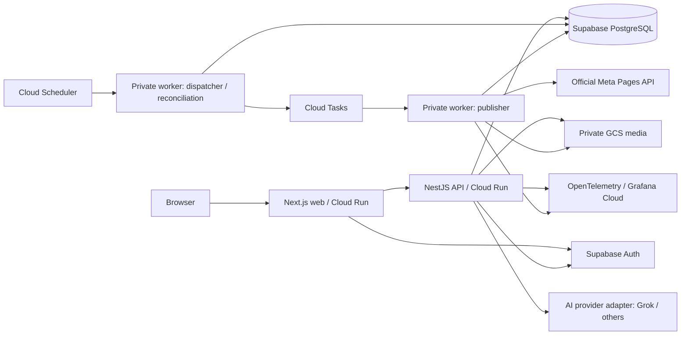

# Postmeister implementation plan

Status: proposed implementation baseline. Prepared 7 November 2026. Repository: https://github.com/acaacx/postmeister. This plan describes a new modular, AI-native social publishing application; it does not assume that existing Postiz source code will be copied. Review dependency and asset licenses before reuse. Public source is allowed; product open-source license remains an explicit repository decision.

## 1. Product outcome and MVP scope

Postmeister lets a team create AI-assisted content, review an exact revision, and schedule reliable publishing to Facebook Pages. Start with a few internal users and Pages while enforcing tenant boundaries from the first migration. The MVP includes sign-in, workspace membership, Page connection, text/link and single-image composition, media management, calendar/list views, revision history, approval/rejection, scheduling, delivery status, reconnect flows, and audit history. AI suggests content; users decide what is approved and published.

Defer video/Reels, Instagram, LinkedIn, inbox management, engagement analytics, billing, arbitrary automation execution, and autonomous publication until the publishing and isolation gates pass. Delivery analytics in the MVP means success, delay, retries, and failures, not engagement metrics. External client onboarding depends on Meta access approval; an internal Page pilot is a separate release gate.

## 2. Architecture and module boundaries

Use a TypeScript monorepo with Next.js frontend and NestJS backend. Deploy three independently versioned Cloud Run services: web, API, and private worker. Keep a modular monolith inside the API/worker packages so domain changes remain transactional without introducing distributed microservices. API and worker share domain code and database migrations, not each other's HTTP internals.

Suggested layout: `apps/web`, `apps/api`, `apps/worker`, `packages/domain`, `packages/contracts`, `packages/db`, `packages/providers`, `packages/observability`, `infra/gcp`, and `docs`. Modules own identity/membership, content/revisions, approval, scheduling/publication, media, social connections, AI assistance, and audit. Enforce imports so provider SDKs remain in infrastructure adapters. Use REST/OpenAPI with runtime validation and generated client types; keep transport DTOs separate from persistent models.

Define narrow ports: `IdentityVerifier`, `MediaStore`, `TaskDispatcher`, `SocialPublisher`, `AIProvider`, `CredentialVault`, and `Telemetry`. The database uses Prisma plus reviewed SQL migrations for constraints, indexes, and RLS. Repository interfaces belong at business transaction boundaries; avoid a generic repository abstraction that hides locking or SQL semantics. Keep standard PostgreSQL data types and explicitly inventory extensions.

Choose a GCP region after testing user latency and Supabase region proximity; Singapore is a candidate, not an assumed residency requirement. Co-locate Cloud Run, Tasks, and GCS. Supabase is external to GCP, so measure database latency and cross-cloud transfer. Use request-based Cloud Run billing, zero minimum instances initially, bounded maximum instances, and small database pools. A worker completes durable work inside its HTTP request; do not launch detached background promises after responding. Google documents the CPU/billing distinction in [Cloud Run billing settings](https://docs.cloud.google.com/run/docs/configuring/billing-settings).

## 3. Data model and tenant isolation

Use application-generated UUIDs and UTC `timestamptz`. Store an IANA timezone with each schedule and show the resolved UTC instant before confirmation. Reject nonexistent daylight-saving times and ask users to choose an offset for ambiguous times. Recurrence is deferred; ordinary posts may be scheduled beyond the task queue's future horizon.

| Entity | Important fields and invariants |
| --- | --- |
| `users`, `auth_identities` | Stable application user ID; unique identity issuer/subject mapping; auth provider IDs do not become domain primary keys. |
| `tenants`, `memberships` | Tenant and user IDs; unique membership; owner/admin/editor/approver/viewer roles; explicit permissions. |
| `social_connections` | Tenant, provider, Page ID, connection status, scopes, credential reference, expiry/revalidation metadata. Prevent silent Page takeover across tenants. |
| `posts`, `post_revisions` | Stable post ID, immutable revision number/content hash, author, caption, link, media references, platform payload. Optimistic concurrency version. |
| `approvals` | Exact revision/hash, approver, decision, timestamp, policy version; approval is immutable evidence. |
| `publications` | Tenant, target connection, approved revision, schedule time, generation, state, stable operation key, external post ID, next attempt time, lease metadata. |
| `publication_attempts` | Operation/attempt ID, start/end, outcome class, sanitized provider response/error metadata; append-only history. |
| `media_assets` | Tenant, provider/bucket/object key, checksum, MIME/size, validation state, retention metadata. |
| `outbox_events` | Transactionally committed event ID/type/reference; due time, dispatch state, attempts. |
| `audit_events`, `ai_runs` | Actor/tenant/action/object/trace/time; AI provider/model/prompt-template version, usage/cost estimate and output lineage. |

Every tenant-owned table has non-null `tenant_id`; composite foreign keys include tenant ID so a post cannot reference another tenant's Page, media, approval, or revision. Unique constraints cover publication operation keys and provider external IDs where meaningful. Index due publications and pending outbox rows with partial indexes. Application queries always scope tenant and check current membership; a tenant ID supplied by a client is never sufficient authorization.

Put application tables in a private schema with no browser Data API grants. Run API/worker connections as non-owner, non-superuser roles without `BYPASSRLS`; retain a separate migration role. Add RLS policies based on transaction-local authenticated actor and tenant context established only after verified membership. Use `SET LOCAL` inside each transaction so pooled connections cannot leak context; test this explicitly. Workers use a scoped execution path that verifies publication-to-tenant association. Supabase service credentials can bypass RLS, so never use them as the ordinary application database access path. See [Supabase RLS guidance](https://supabase.com/docs/guides/database/postgres/row-level-security).

## 4. Approval and scheduling contract

Content states are draft, in review, approved, and archived. Publication states are scheduled, queued, publishing, retry waiting, succeeded, failed, cancelled, and outcome unknown. Keep content review and delivery state separate: one approved revision can produce distinct deliveries to different destinations.

Editors submit an immutable revision for review. Approvers approve or reject that revision. Editing caption, media, destination, or other publishable material creates a new revision and invalidates the prior approval for future publishing. For MVP, changing the scheduled instant also requires confirmation by an authorized approver; record that scheduling decision. Tenant policy may allow the same person to author and approve for a personal workspace; client workspaces default to different actors. Enforce the rule on the server.

Scheduling requires an approved revision, active connection, validated media, future time, and authorization. The transaction creates/updates the publication and its outbox event together. HTTP mutation endpoints accept an idempotency key scoped to tenant/actor/action and persist request hash plus response: identical retries return the same result, conflicting reuse returns a conflict. Optimistic version checks reject stale editor changes.

## 5. Durable and idempotent publishing

PostgreSQL is the schedule of record. A single Scheduler job runs a dispatcher every minute; a second periodic reconciliation job repairs stale queue/outbox state and detects exhausted retries. The dispatcher claims bounded batches using row locking/`SKIP LOCKED`, selects publications within a short rolling horizon (for example 24 hours), and creates Cloud Tasks named from publication ID plus schedule generation. Cloud Tasks permits scheduling only 30 days ahead and retains tasks for 31 days; keeping long schedules in PostgreSQL avoids this limit. Its deduplication window is finite and duplicate execution can occur, so task names are only an optimization. See [limits](https://docs.cloud.google.com/tasks/docs/quotas) and [delivery behavior](https://docs.cloud.google.com/tasks/docs/common-pitfalls).

An enqueue network failure may leave a task created but the outbox unmarked. Retrying the same task name is safe; the worker also verifies database state. Task payloads contain IDs, generation, and trace context, never OAuth tokens or full post bodies. Worker invocation uses an OIDC identity with only Cloud Run Invoker access; API and dispatcher identities receive only their necessary enqueue/read permissions. [Cloud Run service authentication](https://docs.cloud.google.com/run/docs/authenticating/service-to-service) documents the identity model.

Before sending, the worker transactionally checks state, generation, due time, approval hash, media state, connection state, and cancellation. It claims a lease with a monotonically increasing fencing token and records a publishing attempt. Duplicate invocations return success without another provider call when the operation already succeeded or has an active attempt. Do not hold a database transaction open during Meta HTTP requests. Set a bounded provider timeout shorter than the task handler deadline. A stale lease may be reclaimed only when the prior request outcome is known safe; fencing prevents stale workers from overwriting database results but cannot cancel an already accepted external request.

Persist the returned external post ID immediately on confirmed success. Retry definitive transient rejections using exponential backoff, jitter, provider rate-limit headers, bounded attempts, and an age/deadline limit. Permanent validation errors fail visibly; revoked/expired access requires reconnection. Use queue limits plus per-Page persisted throttling to avoid one tenant consuming all capacity. Exhausted operations enter a durable failed state with an operator action; Cloud Tasks is not assumed to supply a dead-letter queue automatically.

If a timeout, connection loss, or crash occurs after Meta might have accepted the post, set `outcome_unknown` and stop automatic resend. Reconcile using a returned ID or provider-supported evidence. Matching content/time alone is not conclusive; unresolved cases require an authorized human to mark resolved or explicitly retry with a duplicate warning and audit entry. Do not claim exactly-once delivery across PostgreSQL and Meta unless the selected endpoint supplies a verified idempotency primitive. Local operation keys prevent routine duplicates; they cannot eliminate the external ambiguous-outcome problem.

Cancellation/rescheduling increments generation and invalidates stale tasks. Workers re-check immediately before sending; once the provider request begins, cancellation is best effort and the UI must show that boundary. A new publication after confirmed success is a deliberate republish with a new operation key.

## 6. Facebook Pages integration

Implement an official Graph API adapter only. Phase 0 proves text/link and single-photo publishing on a controlled Page, enumerates Pages the user can manage, exchanges/stores Page credentials securely, and validates reconnection and revoked permissions. Expected permissions include `pages_show_list`, `pages_read_engagement`, and `pages_manage_posts`; verify the exact set, Page tasks, product/use-case configuration, token behavior, and access level against the selected API version in the actual Meta app before committing to scope.

Pin a supported Graph API version in configuration, record its retirement date, and create an upgrade issue before it expires. Do not invent a current version in code or assume Page tokens never expire. Validate permissions and connection health periodically and before publishing. The production checklist includes privacy policy, terms, data-deletion handling, allowed redirect URLs, review screencast/test instructions, required business verification/App Review/Advanced Access, and a live test by a user outside app roles where applicable. Meta approval timing is an external dependency, not part of the engineering estimate.

Primary references are [Pages getting started](https://developers.facebook.com/docs/pages-api/getting-started/), [publishing posts](https://developers.facebook.com/docs/pages-api/posts/), and [App Review](https://developers.facebook.com/docs/app-review/). These pages returned HTTP 429 during this research session; permission details and review eligibility remain a Phase 0 verification gate rather than a claim of fully verified current requirements. Do not substitute unofficial SDK claims for that check.

## 7. AI studio and media portability

An `AIProvider` adapter supports caption ideas, rewriting, tone changes, and platform variants with structured outputs, cancellation, timeouts, and normalized usage. Start with a configurable Grok adapter and a deterministic fake provider for tests; add other vendors behind the same contract. Select the actual model after an evaluation of output quality, latency, privacy terms, and current unit prices. Store prompt template/version and generation lineage; do not store secrets or full private prompts in general logs. Redact personal data, limit uploaded context, and make external AI processing visible to the user.

AI has no publishing credentials or direct publish tool. Generated text is untrusted and enters the normal draft/revision/approval workflow. Validate structured responses and URLs, escape rendered output, isolate tenant context, enforce per-user/tenant request and token budgets, and require confirmation before accepting paid generations. Avoid arbitrary web fetching and tools in MVP. Measure usefulness with a fixed prompt set and human review; adapter tests alone do not measure quality.

Use private GCS Standard storage for MVP through `MediaStore`: create scoped upload, finalize/validate, retrieve metadata, create short-lived read URL, delete, and copy/export. Persist logical object coordinates, checksum, and MIME type rather than permanent public URLs. Validate file size, magic bytes, dimensions, and supported formats; quarantine before use and strip unnecessary metadata. A backend streams media to Meta or issues a narrowly scoped temporary URL only when the API requires it. Bucket paths containing tenant IDs do not provide authorization by themselves. S3 and optional Supabase Storage adapters must pass the same contract tests. Add lifecycle cleanup for abandoned uploads and retained revisions, with safeguards against deleting referenced assets.

## 8. Security and operations

Use Supabase Auth for MVP; API verifies issuer, audience, signature/JWKS, expiry and application membership. Prefer secure, HttpOnly, SameSite cookies with CSRF protection for browser sessions; avoid tokens in URLs and logs. Keep authorization in the API and re-check membership/role on sensitive actions. OAuth callback state is single-use, short-lived, and bound to the initiating user/tenant; use PKCE when supported and allowlist redirect destinations.

Keep deployment secrets in Secret Manager and encrypt stored social refresh/Page credentials using envelope encryption with Cloud KMS; store key version and support rotation. Separate web, API, worker, migration, and deployment identities. GitHub Actions uses workload identity federation restricted to the confirmed repository and approved environment/ref, with no long-lived GCP key. Production and staging use separate credentials/resources. Mask provider responses and headers before logging. Add secret scanning, dependency scanning, locked builds, container scanning, least-privilege permissions, and branch protection compatible with the repository's workflow.

Validate all inputs; protect outbound URL fetches against SSRF, use restrictive CORS/CSP, rate-limit auth/AI/publishing actions, and cap payload sizes. Never expose Supabase service keys, database URLs, KMS material, OAuth secrets, or Grafana ingestion credentials to the browser or public repository. Commit only placeholder configuration examples. Keep durable audit records for membership, approvals, connection changes, publishing decisions, and manual reconciliation. Define retention/export/deletion policy, tenant offboarding, credential revocation, and media cleanup before external onboarding.

Instrument HTTP, database, AI, dispatcher and publish attempts with OpenTelemetry and propagate trace context across Tasks. Export OTLP to Grafana Cloud using bounded batches and explicit flush within the request/shutdown lifecycle; verify behavior with scale-to-zero. Direct export is acceptable for the pilot with documented loss tolerance. Evaluate an Alloy/Collector deployment before wider production because Grafana recommends a collector for reliable transport/redaction, and include its always-on cost if chosen. See [Grafana OTLP architecture](https://grafana.com/docs/grafana-cloud/send-data/otlp/send-data-otlp/).

Dashboards cover queue age, dispatch lag, outbox backlog, publish success/failure/unknown outcomes, connection health, DB pool saturation, API latency/error rate, AI token spend, and telemetry loss. Do not use tenant/user/publication IDs as metric labels; retain correlation IDs only in restricted logs/traces. Alert on old due posts, unknown outcomes, dispatcher absence, expired credentials, and budget thresholds. Initial service objective: 99% of eligible pilot publications begin a provider attempt within five minutes of schedule time over 30 days, excluding explicitly paused operations; report provider acceptance separately from internal latency. A missed target must remain visible, not hidden by exclusions.

Back up application data and object manifests; pilot targets are RPO 24 hours and RTO four hours, verified by a timed restore exercise. Stronger targets require PITR and revised cost. Document queue pause, provider outage, database outage, token compromise, duplicate suspicion, and rollback runbooks. Rollbacks must retain database compatibility and never replay externally ambiguous attempts.

## 9. Supabase exit and AWS portability

Treat database migration and identity migration as separate projects. First move only application PostgreSQL data to Cloud SQL or RDS while retaining Supabase Auth if useful. Preserve application IDs, schemas, constraints, RLS semantics, and migrations. Rehearse dump/restore on the target PostgreSQL major version; inventory unavailable extensions/roles, compare row counts/checksums, run isolation and publisher tests, and benchmark connection behavior. For small MVP data, use an announced write freeze: pause dispatch, drain in-flight attempts, snapshot/restore, validate, switch configuration, resume, reconcile. Define rollback before reopening writes; once writes resume on the target, switching back requires reverse synchronization, not just an old connection string.

Later choose managed alternative identity or self-hosted Supabase Auth. Preserve issuer/subject mappings; test password/hash compatibility, social OAuth callbacks, email delivery, MFA, refresh tokens, signing-key rotation, session invalidation, and recovery. An ORM does not migrate Auth. Supabase documents auth-schema migration between its projects but that does not guarantee compatibility with another identity provider: [Auth migration notes](https://supabase.com/kb/troubleshooting/migrating-auth-users-between-projects).

| Boundary | GCP baseline | AWS future |
| --- | --- | --- |
| Containers | Cloud Run | ECS/Fargate; Lambda requires a separate runtime assessment |
| PostgreSQL | Supabase then Cloud SQL | RDS PostgreSQL |
| Queue/schedule | Tasks + Scheduler adapter | SQS + EventBridge Scheduler adapter with equivalent DB invariants |
| Objects | GCS adapter | S3 adapter |
| Secrets/encryption | Secret Manager/KMS | Secrets Manager/KMS adapter |
| Telemetry | OpenTelemetry/OTLP | Same instrumentation/backend |

Portability means tested seams and a migration runbook, not simultaneous multi-cloud deployment. Add CI against vanilla PostgreSQL early and one target-cloud migration rehearsal before promising an exit date.

## 10. Roadmap and issue-ready backlog

Planning range: roughly 9–13 engineer-weeks for one experienced full-time engineer, plus Meta review, a 30-day pilot observation window, and user acceptance calendar time. Estimates require adjustment after repository inspection and the Phase 0 spike. Each row can become a milestone with the listed issue titles; create live issues only in the confirmed repository and avoid duplicating existing work.

| Milestone | Issue titles / deliverables | Exit criteria |
| --- | --- | --- |
| M0: feasibility and decisions, 1 week | Meta Page publishing spike; region/latency and DB pooling spike; repository/license/dependency baseline; architecture ADRs and threat model | Controlled Page text/photo publish succeeds; exact permissions/version/review path recorded; proposed costs measured; deployment boundaries documented. |
| M1: foundation and isolation, 1–2 weeks | Monorepo and CI; GCP infrastructure and identity federation; Supabase Auth adapter; tenant schema/RLS and audit | Staging deployed from CI without stored cloud keys; cross-tenant CRUD/media/role tests fail closed; plain PostgreSQL migration passes. |
| M2: content and approvals, 2 weeks | Composer/media validation; immutable revisions; approval policy; calendar/timezone UX | Editing approved material invalidates approval; stale updates fail; DST tests and reviewer permissions pass; keyboard-accessible core flow. |
| M3: publishing engine, 2–3 weeks | Transactional outbox/dispatcher; Tasks worker leases; Meta adapter; retries/reconciliation/cancel | Duplicate, crash, timeout, stale-generation and outage tests pass; unknown external outcomes stop automatic resend; manual resolution audited. |
| M4: AI and operations, 1–2 weeks | Grok/fake AI adapters; quotas/evaluation; OTel/Grafana; alerts/runbooks; restore rehearsal | AI cannot bypass approval; usage caps work; failure trace crosses queue; simulated incident alerts; timed restore meets stated RPO/RTO. |
| M5: pilot and release, 2–3 engineer-weeks plus observation | Meta external access package; security review; load/fault testing; portability rehearsal; contributor docs | 30-day pilot data meets delivery objective; zero unresolved isolation defects; external-client gate verified; operational owner accepts runbooks. |

For each issue include context, owning module, dependencies, schema/API changes, acceptance criteria, test evidence, operational impact, and estimate. Label by module and milestone; avoid creating dates until capacity and external review timing are known. Record ADRs for GCP deployment shape, Supabase separation, durable publication/outcome handling, and tenant isolation using the existing repository convention.

## 11. Release acceptance and validation

Use unit tests for state transitions, approval binding, permission checks and provider error classification. Use real PostgreSQL integration tests for tenant constraints/RLS, transaction rollback/outbox atomicity, competing worker claims, fencing, and pooled transaction context. Use provider contract fixtures plus a controlled live Page smoke test; never send posts to production Pages from routine CI. Run browser tests for draft → review → schedule → status, rejection, reconnect, cancel, media upload, keyboard access, and timezone rendering.

Fault tests must cover duplicate tasks, enqueue success followed by dispatcher crash, worker crash before send, confirmed success followed by DB failure, ambiguous timeout, lease expiry, reschedule races, revoked approver membership, Meta throttling, exhausted retries, database outage and recovery. Prove that only the approved revision can be sent, every publication has a durable audit trail, and no browser response/log/trace contains credentials. Test that deleted or disabled tenant membership takes effect on sensitive operations without waiting for a token to expire.

Load-test at ten times expected pilot volume with bounded instance/pool settings; report scheduling lag and connection usage. Complete a database and media restore, credential rotation, deploy rollback, and target PostgreSQL migration rehearsal. Acceptance requires no unresolved critical/high security defects, a visible unknown-outcome recovery flow, and documented costs from the pilot's actual usage.

## 12. Cost model and controls

All amounts are USD/month planning envelopes as of 7 November 2026, before tax, domain, developer labor, paid support, and Meta review effort. Assumptions: 1–5 users, 1,000 publications/month, 100,000 combined HTTP requests, approximately 20,000 active vCPU-seconds and 10,000 GiB-seconds, 5 GiB retained media, 10 GiB outbound media, two Scheduler jobs, under 10,000 Tasks operations, no video transcoding, zero warm minimum instances, and a single small Supabase project. Free allowances are shared by billing account and may already be consumed. Regional/network pricing must be priced in the calculator after region selection.

| Component | Pilot envelope | Basis and growth trigger |
| --- | --- | --- |
| Cloud Run web/API/worker | $0–10 | Small active compute; cold starts allowed. Use [regional pricing calculator](https://cloud.google.com/run/pricing); min instances and a collector change this. |
| Tasks + Scheduler | $0–1 | Tasks first 1M billable operations free, then $0.40/M; payload chunks and retries count. Scheduler first 3 jobs free, then $0.10/job/31 days. [Tasks pricing](https://cloud.google.com/tasks/pricing), [Scheduler pricing](https://cloud.google.com/scheduler/pricing). |
| GCS, operations and transfer | $1–5 | Illustrative allowance for 5 GiB stored/10 GiB delivered; egress can exceed storage. [Storage rates](https://cloud.google.com/storage/pricing). |
| Supabase | $0 development; $25+ production | Pro starts at $25 with one Micro-sized project covered by compute credits; extra projects/compute/egress/PITR add cost. Free projects can pause after inactivity. [Supabase pricing](https://supabase.com/pricing). |
| Grafana Cloud | $0 within limits; $19+ usage for Pro | Free logs/traces each up to 50 GB ingested and 14-day retention; verify all signal/cardinality allowances. [Grafana pricing](https://grafana.com/pricing/). |
| Secrets/KMS/builds/artifacts/logs/email | $2–10 allowance | Include encryption keys/operations, image retention, CI build minutes and production auth email; measure rather than assume free. |
| AI | $5–25 explicit pilot cap | Budget envelope, not a quoted Grok tariff. Estimate requests × input/output tokens × selected model rates; disable on cap. |

Development envelope is about $3–26/month excluding AI, with Free Supabase and Grafana; a small production pilot is about $28–51 excluding AI, or $33–76 with the stated AI cap. These are estimates, not service quotations or a guarantee. Add at least $19 plus usage if Grafana Pro is selected; add staging database, warm instances, collectors, stronger backups or high-volume media separately. Cloud SQL/RDS are provisioned database cost decisions: do not promise they will be cheaper than Supabase; compare regional instance, HA, storage, backup and transfer pricing at migration time.

Set billing alerts at 50/80/100% of an initial $75 pilot budget, per-tenant AI/media quotas, maximum Cloud Run instances, queue concurrency limits, telemetry sampling/cardinality limits, media retention, and artifact cleanup. Billing alerts alone are not spend caps. Review the first week's actual billing and publish a revised forecast before external-client launch.
